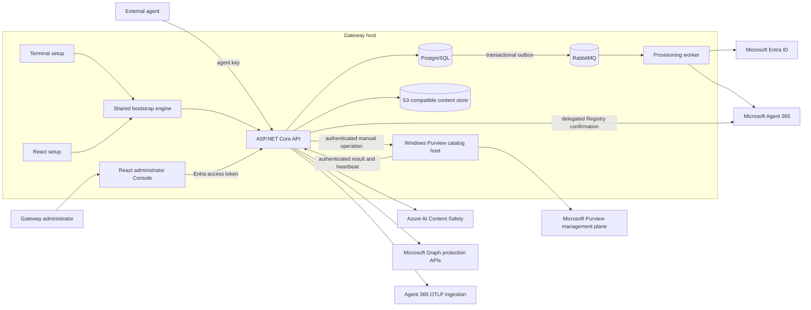
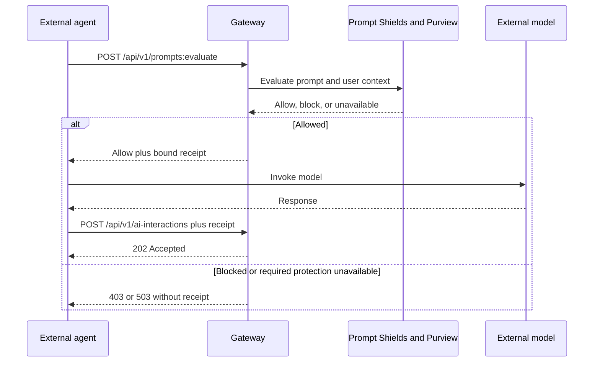

# A365 Custom Gateway

**Release channel: Beta**

**Authors:** [Patrick Shim](mailto:patrickshim@microsoft.com) (Senior Sales Advisor, AI Security GBB, Microsoft Corp.) and [Hyuna Kim](mailto:hyunakim@microsoft.com) (Security Solution Engineer at Microsoft Korea)

**License:** [MIT](LICENSE)

See [Contributing](CONTRIBUTING.md) for development and review practices and
[Security](SECURITY.md) for safe vulnerability reporting. The MIT license permits
Microsoft and the wider community to use, review, modify, and redistribute this
software under the same terms.

A365 Custom Gateway connects independently hosted AI agents to Microsoft Entra
agent identities, Microsoft Agent 365, Microsoft Purview DLP, and Azure AI
Content Safety Prompt Shields. The agent keeps its model, tools, and hosting. The
gateway supplies the identity, policy enforcement, telemetry, and administrative
control needed to operate it in a Microsoft 365 environment.

The result is one control point for registering external agents, issuing scoped
credentials, checking prompts before a model call, applying existing Purview
policies to individual agents, and sending Agent 365 activity and observability
data.

> **Current release scope:** the included Docker Compose topology is intended for
> local development and evaluation. The Agent 365 Registry integration uses a
> development-gated preview. Production hosting requires deployment-specific TLS,
> durable secret management, infrastructure hardening, and service supervision.

## Why this project exists

An external agent can run anywhere, but Microsoft governance features need a
stable identity and a trustworthy enforcement path. This gateway gives every
registered agent its own identity and API key, then keeps four concerns distinct:

- **Identity:** individual Entra agent identity and Agent 365 registration.
- **Admission:** revocable gateway access for that one registered agent.
- **Protection:** Prompt Shields and Purview decisions before the model runs.
- **Visibility:** activity and OpenTelemetry export to Agent 365 and Microsoft
  security experiences.

Purview policy authors retain ownership of policies, rules, sensitive information
types, classifiers, actions, and exclusions. Gateway administrators select from
the existing compatible policy catalog and apply a policy to the exact individual
agent identity. The gateway does not create DLP policy content.

Policy owners can separately run the [standalone Purview agent DLP script](tools/scripts/setup/purview-agent-dlp.md)
on their Windows PC to create a new Application-plane policy using existing SITs.
The single script needs no Gateway deployment or credentials. It previews by
default, verifies the tenant and individual identity, and creates only with
`-Apply`; existing policies and rules are never overwritten.

## Highlights

- Guided terminal and React setup experiences backed by the same PowerShell
  bootstrap engine.
- Individual agent registration under a reusable Entra Agent ID blueprint.
- One-time, revocable, per-agent gateway credentials.
- Inline prompt evaluation with fail-closed behavior for required protection.
- Independent per-agent Prompt Shields configuration.
- Existing Purview policy discovery and reviewed per-agent assignment.
- Agent 365 activity and direct OpenTelemetry export.
- Administrator Console with persistent light and dark themes.
- Clear loading, refreshing, success, warning, blocked, and failure feedback that
  preserves the last confirmed state while background checks run.
- Built-in agent simulator that exercises the real gateway APIs without calling
  a language model.
- Single-file Python echo sample that shows the pre-model protection boundary with
  one Gateway API call and no UI, model, framework, or package dependency.
- Standalone Python/Flask live-agent sample that calls an Azure AI Foundry
  deployment, discovers a public-weather tool through a separately supervised MCP
  container, and uses a registered agent's real gateway protection and interaction
  path. An optional Windows logon supervisor restores the loopback Flask process
  without a repeating trigger or visible terminal window.
- Gateway-only Disable and Enable controls, plus confirmed permanent Agent 365
  deregistration.
- Generated OpenAPI JSON/YAML and an interactive API reference.

## Architecture



The API and worker use .NET 10. PostgreSQL stores registrations, protection
configuration, receipts, audit records, idempotency state, and outbox messages.
RabbitMQ carries provisioning work, and S3-compatible storage holds interaction
content. Docker Compose runs the API, worker, Console, and local data services.
The included Vault development container is not connected to the application;
bootstrap supplies secrets through ignored host files and generated environment
configuration.

Purview has two independent paths:

- **Management:** a Windows certificate-backed listener reads existing policies
  and applies reviewed individual-agent targets. Bootstrap installs a supervised background
  task under the certificate-owning user. After the initial verified catalog,
  only explicit Connect, Reconnect, Manual sync, or assignment operations contact
  the management provider.
- **Runtime:** the Gateway uses the individual agent identity for Graph scope
  checks and `processContent`. Required provider failure blocks the request.

The last accepted policy catalog remains available during failed syncs or
management outages, without age-based expiry. Assignment execution still checks
live policy revision and exact target scope. Public `revision` protects review
concurrency; internal `definitionRevision` identifies enforcement semantics.
Adding another reviewed target does not invalidate an unchanged existing
assignment. See the [policy guide](docs/architecture/purview-policy-consumption.md).

Docker services restart with Docker. The Console proxy re-resolves the API after
container replacement. The Purview listener additionally requires the configured
Windows user to sign in. Heartbeat health, policy assignment, runtime enforcement,
and downstream visibility are reported separately.

See the [technical specification](SPEC.md),
[system architecture](docs/architecture/system-architecture.md),
[connector design](docs/spec/purview-connector-vnext.md), and
[roadmap and release gates](SPEC-VNEXT.md) for the detailed boundaries.

## Prerequisites

The complete local feature set currently requires a Windows x86-64 host because
the Purview management connector uses the Windows certificate store and Security
& Compliance PowerShell.

Install:

- Git
- PowerShell 7 or later (`pwsh`)
- .NET SDK `10.0.400` or a newer `10.0.4xx` patch, as pinned by `global.json`
- Docker Desktop or Docker Engine with the Compose plugin and Linux containers
- Azure CLI
- Bicep CLI when bootstrap provisions Content Safety (`az bicep install`)
- Node.js 20 and npm for the graphical installer (`gateway.cmd gui`) or local
  frontend development; the terminal installer builds frontend images in Docker
- Python 3.11 or later only for the optional Python samples

Each installer uses its own Microsoft tenant, service licenses/entitlements, and
Azure subscription when provisioning Content Safety. No author-owned tenant or
credentials are included or required. Deployment requires authority to
create or configure the reviewed applications and permissions. Agent 365 Registry
confirmation uses delegated administrator access; Purview management has separate
certificate and role requirements. Review the [bootstrap guide](bootstrap/README.md)
and [Microsoft integration requirements](docs/architecture/microsoft-capabilities.md)
before installing into a tenant.

The [Linux dependency installer](tools/scripts/setup/README.md) supports Ubuntu
22.04, 24.04, and 26.04 on x86-64. Linux can build and run the containerized
gateway, but the current Purview catalog and assignment host still requires its
configured Windows account. A fully self-contained remote connector is documented
as deferred work and is not part of this release.

## Download and deploy

Clone the repository:

```powershell
git clone https://github.com/patrick-shim/a365-custom-gateway-public.git
cd a365-custom-gateway-public
```

For the guided terminal installation on Windows:

```powershell
.\gateway.cmd up
```

`up` collects configuration when needed, checks prerequisites and Microsoft
sign-in, shows the exact plan, asks for acceptance, provisions owned resources,
builds and starts the containers, and verifies the local endpoints.

For explicit control over each stage:

```powershell
.\gateway.cmd init
.\gateway.cmd plan
.\gateway.cmd apply
.\gateway.cmd verify
.\gateway.cmd open
```

For the graphical installer:

```powershell
.\gateway.cmd gui
```

For a Linux development host after installing the documented prerequisites:

```bash
chmod +x ./gateway
./gateway up
```

Choose Purview disabled for this profile. The current Linux runtime cannot
provision or run the certificate-backed Purview management component. Before
starting services, bootstrap gives the non-root worker ownership of its dedicated
blueprint-credential directory; the API mounts that directory read-only.

The terminal and graphical installers collect the same settings and invoke the
same bootstrap engine. Setup explicitly covers tenant identity, Agent 365,
Content Safety, and Purview management access. It never creates Purview policies,
rules, classifiers, or sensitive information types.

Local installation state is stored in ignored files:

- `bootstrap/config.json` contains the selected non-secret configuration.
- `.bootstrap/` contains checkpoints, generated credentials, certificates,
  source-bound plans, and provider transport material.
- `deploy/runtime/.env.runtime` contains generated runtime configuration.

Keep these files secure and preserve them across normal rebuilds. Never commit
them or copy their secret values into issues, logs, or documentation.

## Local endpoints

| Address | Purpose |
| --- | --- |
| `http://127.0.0.1:5081` | Administrator Console |
| `http://127.0.0.1:5081/docs` | Interactive API reference through the Console |
| `http://127.0.0.1:5080/docs` | Interactive reference on the API listener |
| `http://127.0.0.1:5080/openapi/v1.json` | Generated OpenAPI JSON |
| `http://127.0.0.1:5080/openapi/v1.yaml` | Generated OpenAPI YAML |
| `http://127.0.0.1:5080/health` | API liveness |
| `http://127.0.0.1:5080/health/ready` | API and database readiness |

Ports are configurable during setup. The listeners bind to loopback in the local
Compose profile.

## Container architecture

Build application images for your Docker host's native architecture. The runtime
validation workflow runs separately on x64 and ARM64 and publishes
`runtime-images-X64` and `runtime-images-ARM64` artifacts. Match the artifact to
`docker info --format '{{.Architecture}}'`; x64 validation does not establish that
.NET application images work under ARM emulation. The existing S3 development
image uses x64 compatibility support on ARM hosts.

## Quiet Windows connector

The Purview catalog host stays running in the background while its certificate-owning
Windows user is signed in. It is a windowless executable, starts automatically at
that user's Windows sign-in, and launches provider PowerShell processes without
console windows. A one-minute Task Scheduler recovery trigger starts the same
windowless listener only when it is not already running; duplicate starts are
ignored. This does not launch a PowerShell window or refresh the catalog. Native
failure retries are also configured. Persistent failures require repair through
the Console's connection diagnostics.
Bootstrap disables the owned task during binary replacement and reenables it
after successful installation, preventing recovery from racing an upgrade.
The Console reports its heartbeat, so a separate tray application is unnecessary.
After restarting Windows, sign in to that account to restore the connector. Signing
out stops this user-scoped component; Docker runtime protection is independent of
catalog-host liveness. See [runtime operations](docs/runtime/README.md#quiet-background-connector).

## First use

1. Sign in with a user assigned an appropriate Gateway role.
2. Register an agent and complete its Agent 365 Registry confirmation.
3. Save its one-time Gateway API key securely.
4. Open **Protection setup**, enable Prompt Shields, and select an existing
   compatible Purview DLP policy.
5. Review the exact agent/policy change and choose **Assign policy**.
6. Wait for **Assigned**, which confirms that Purview includes this individual
   agent. The request continues in the background if you leave the page.

No agent key, synthetic sample or extra protection-verification step is required
for policy assignment. You can use the agent after assignment is confirmed.
Prompt Shields and Purview evaluate actual requests using the configured settings;
required protection continues to fail closed if unavailable. **Test Agent** remains
available separately when you want to inspect request outcomes.

An assignment confirmation records the policy target; it is not a claim that a
particular request was tested or that data is visible downstream. Deployment
validation can independently exercise normal allow, provider-specific blocks and
same-blueprint sibling scope.

External agent IDs are 3–128 characters, start with a letter or number, and may
contain letters, numbers, dots, hyphens, and underscores. The Console validates
this before submission, and the API returns a field-level `400` response for an
invalid ID instead of starting registration.

Agent 365 Registry confirmation is bounded by the interactive request window. If
Microsoft Graph throttles the request or has not made the exact record readable,
the Gateway pauses safely and reports that the outcome is unconfirmed. Wait
briefly, refresh status, and reconcile the same operation;
the Gateway does not blindly create a second Registry record.

## Agent request flow

External agents must evaluate the exact prompt before invoking their model:



The receipt is bound to the agent, interaction, prompt hash, user context,
timestamp, protection revision, and current assignment evidence. It expires and
can be consumed only once. An agent must not call its model after a block or an
unavailable required protection response.

Purview catalog freshness, public whole-scope `revision`, and durable internal
`definitionRevision` are separate checks. Refreshing a trusted catalog, renaming
the policy, or adding an unrelated exact agent target does not invalidate another
agent's in-flight receipt when its all-accounts target remains present and its
`definitionRevision` is unchanged. Removing that agent's target, narrowing or
excluding it, changing its enforcement definition or compatibility, or changing
the agent setting or protection revision invalidates the receipt and requires a
new protected turn.

Minimal PowerShell example:

```powershell
$base = 'http://127.0.0.1:5080'
$externalAgentId = Read-Host 'Registered external agent ID'
$headers = @{
    Authorization = "Bearer $env:GATEWAY_AGENT_KEY"
    'Idempotency-Key' = [guid]::NewGuid().ToString()
}
$request = @{
    externalAgentId = $externalAgentId
    interactionId = [guid]::NewGuid().ToString()
    occurredAtUtc = [DateTime]::UtcNow.ToString('o')
    userContext = @{ tenantUserObjectId = $env:GATEWAY_TENANT_USER_ID }
    prompt = @{ contentType = 'text/plain'; content = 'Explain what a gateway does.' }
}

$evaluation = Invoke-RestMethod "$base/api/v1/prompts:evaluate" `
    -Method Post -Headers $headers -ContentType 'application/json' `
    -Body ($request | ConvertTo-Json -Depth 8)

if (-not $evaluation.allowed -or
    -not $evaluation.evaluationId -or
    $evaluation.evaluationId -ne $evaluation.evaluationReceiptId) {
    throw 'The gateway did not authorize the model call.'
}

$modelResponse = 'A gateway connects services.' # Replace with the real model call.
$request.response = @{ contentType = 'text/plain'; content = $modelResponse }
$request.promptEvaluationReceiptId = $evaluation.evaluationReceiptId
$headers['Idempotency-Key'] = [guid]::NewGuid().ToString()

Invoke-RestMethod "$base/api/v1/ai-interactions" `
    -Method Post -Headers $headers -ContentType 'application/json' `
    -Body ($request | ConvertTo-Json -Depth 8)
```

Administrative endpoints use an Entra access token for the Gateway API. Agent
ingress endpoints use a gateway-issued agent key. Both use the Bearer header, but
the credentials are not interchangeable. Preserve an idempotency key when retrying
the same uncertain operation and generate a new key for a new operation.

## Minimal Python echo sample

[`samples/echo-agent.py`](samples/echo-agent.py) is the smallest runnable external
agent example. It prompts for an existing Active external agent ID, that
registration's matching Gateway key, an Entra user object ID, and a message. Press
Enter at the message prompt to send `hello world`.

```powershell
python samples/echo-agent.py
```

The script uses only the Python standard library and makes exactly one
`POST /api/v1/prompts:evaluate` call. It prints the Gateway's allow or block result
and stops. It does not register or provision an agent, call a model, submit
activity, or submit a completed interaction. An allow receipt returned by this
beta sample is intentionally unused and expires. Use the Console to create the
registration and save its key before running the script. The result demonstrates
the pre-model Gateway boundary; it is not proof of visibility in Agent 365,
Purview, or Defender. Set `GATEWAY_BASE_URL` only when the API is not at the local
default `http://127.0.0.1:5080`; a non-loopback address must use HTTPS.

## Live Python weather agent sample

The [standalone weather sample](samples/python-foundry-weather-agent/README.md)
uses Flask, an Azure AI Foundry model, and a separate MCP weather container backed
by Open-Meteo. It exercises real Gateway admission, prompt evaluation, activity
telemetry, and receipt-bound response submission. Its deployment is independent
of the Gateway Compose runtime.

Select an Active external agent ID and its matching Gateway key in the sample UI.
There is no default identity. The Gateway rejects a mismatched ID/key pair before
Foundry or MCP runs; changing the ID clears the volatile conversation. Foundry
uses the developer or managed identity through Azure Identity, with credentials
kept in the server process.
On Windows, request-scoped credential helpers run without console windows. The
optional logon task uses `pythonw.exe` so both the sample and its authentication
children stay in the background. Initial `az login` remains an explicit setup step.

**Local beta exception:** the sample saves the selected ID and key in
browser `localStorage`, restores them after reload, and offers a clear action.
Flask keeps the key request-scoped and never stores or returns it. Remove browser
credential persistence before remote or production hosting.

Prompt and response evaluation are enabled by default. Optional request-scoped
comparison controls can skip response evaluation, or both phases; skipped phases
are explicitly labeled unevaluated. These controls do not change Gateway agent
settings. With response evaluation enabled, the sample withholds the candidate
answer until interaction submission succeeds. Acceptance is not proof of
Agent 365, Purview, or Defender visibility.

The sample guide covers prerequisites, environment configuration, startup,
optional Windows logon supervision, recovery, and offline tests. The Console's
built-in **Test Agent** remains a separate simulator that calls no model.

## Administration and operations

The Console provides:

- registration status and seven-step provisioning progress;
- Prompt Shields, data protection, identity, API key, and activity views;
- existing Purview policy selection and per-agent assignment status;
- gateway-only bulk Disable and Enable actions;
- confirmed permanent deregistration from this gateway and Agent 365 Registry;
- a real API-path agent simulator with a clearly labeled simulated response;
- Purview connection diagnostics, explicit Connect/Manual sync actions, and
  current accepted-catalog status.

Disabling an agent immediately rejects new prompt, activity, batch, and
interaction requests at this gateway. It does not change the Agent 365 Registry,
the Entra identity, or Purview policy configuration. Permanent deregistration
requires explicit confirmation and verified Registry removal; Entra identities,
shared blueprints, policies, and audit history are retained.

Useful commands:

```powershell
.\gateway.cmd status
.\gateway.cmd verify
.\gateway.cmd doctor
.\gateway.cmd diagnose
```

`status` reports persisted checkpoints. `verify` performs live local endpoint
checks. `doctor` examines prerequisites and sessions without provisioning.
`diagnose` writes a sanitized support bundle. Health checks do not prove policy
enforcement or downstream Microsoft visibility.

## Repository map

| Path | Responsibility |
| --- | --- |
| `src/Gateway.Api/` | HTTP API, authentication, authorization, middleware, and OpenAPI |
| `src/Gateway.Application/` | Commands, queries, validation, and use-case orchestration |
| `src/Gateway.Domain/` | Entities, state machines, interfaces, and domain models |
| `src/Gateway.Infrastructure/` | PostgreSQL, outbox, RabbitMQ, storage, and credential services |
| `src/Gateway.Agent365/` | Entra Agent ID, Registry, provisioning, and direct OTel adapters |
| `src/Gateway.Purview/` | Runtime Purview policy evaluation and catalog/assignment contracts |
| `src/Gateway.ContentSafety/` | Azure AI Content Safety Prompt Shields adapter |
| `src/Gateway.Provisioning.Worker/` | Asynchronous provisioning workflow |
| `src/Gateway.Purview.CatalogHost/` | Windows certificate-backed policy reader and assignment host |
| `web/console/` | React administrator Console |
| `web/setup/`, `tools/Gateway.Setup/` | React installer and local setup host |
| `bootstrap/` | Shared configuration, planning, provisioning, and lifecycle engine |
| `deploy/runtime/` | Local Docker Compose topology |
| `infrastructure/bicep/` | Optional Content Safety resource provisioning |
| `src/ExternalAgent.Sample/` | C# external-agent integration sample |
| `samples/echo-agent.py` | Minimal standard-library prompt-evaluation example |
| `samples/python-foundry-weather-agent/` | Standalone Flask, Foundry, MCP, and Open-Meteo live-agent sample |
| `tests/` | Executable regression and opt-in integration checks |
| `tools/scripts/` | Setup, diagnostics, maintenance, and explicit live probes |
| `docs/`, `operations/` | Detailed design and operating guidance |

## Installation validation

The [Docker runtime validation workflow](.github/workflows/runtime-validation.yml)
builds the images from public package feeds on a fresh Linux runner. It uses the
same bootstrap image-build, environment-generation, deployment, and health-check
functions as the installer, with synthetic identities and Microsoft provisioning
disabled. It checks API readiness, Console proxying, worker queue consumption,
OpenAPI, isolated PostgreSQL/RabbitMQ regressions, S3 read/write, and the worker
credential directory.

This check establishes container runtime readiness only. Full README acceptance
also requires clean Windows terminal and graphical setup using an operator-selected
Microsoft tenant and dedicated test resources, administrator sign-in, agent
registration, and provider-backed protection.
See [release gates](SPEC-VNEXT.md#m7--release-validation). A passing container check
does not establish tenant eligibility or Purview/Agent 365 enforcement.

## Develop and validate

From a fresh clone, install the frontend dependencies before running checks:

Package restores use public NuGet and npm sources. Cryptography dependencies are
pinned to patched versions where needed; keep those security updates when changing
the dependency graph.

```powershell
npm --prefix web/console ci
npm --prefix web/setup ci
dotnet build Gateway.slnx
npm --prefix web/console run check:reachability
npm --prefix web/console run check:proxy
npm --prefix web/console run typecheck
npm --prefix web/console test
npm --prefix web/setup test
pwsh -NoProfile -File tools/scripts/maintenance/Test-RepositoryLayout.ps1
```

The repository also contains executable .NET regression programs and PowerShell
bootstrap tests. Follow [tests/README.md](tests/README.md) for the complete suite
and the explicit environment variables required by integration tests. A missing
live dependency must produce a skipped result, never a claimed pass.

## Documentation

- [Technical specification](SPEC.md)
- [Roadmap and release gates](SPEC-VNEXT.md)
- [Contributing](CONTRIBUTING.md)
- [Documentation index](docs/README.md)
- [Bootstrap guide](bootstrap/README.md)
- [Runtime operations](docs/runtime/README.md)
- [API contract](docs/api/api-contract.md)
- [Checked-in OpenAPI schema](docs/api/openapi.yaml)
- [System architecture](docs/architecture/system-architecture.md)
- [Purview policy consumption](docs/architecture/purview-policy-consumption.md)
- [Purview catalog host](docs/architecture/purview-catalog-host.md)
- [Console design](docs/console/design.md)
- [Python Foundry/MCP weather agent sample](samples/python-foundry-weather-agent/README.md)

## Contributing and license

Bug reports, reviews, documentation improvements, and focused code contributions
are welcome. Read [CONTRIBUTING.md](CONTRIBUTING.md) for the development workflow
and [SECURITY.md](SECURITY.md) for private vulnerability reporting.

Copyright (c) 2026 Patrick Shim. This project's source and documentation are
available under the [MIT license](LICENSE), including permission for Microsoft
and the wider community to use, modify, publish, and redistribute them subject to
the license terms. Third-party dependencies and Microsoft services retain their
own licenses and terms.
